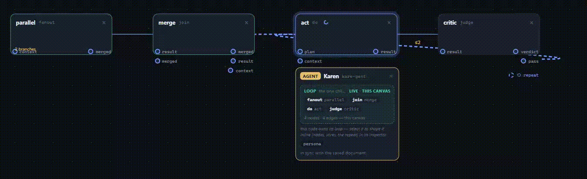

<div align="center">

<br />
<h1>Guts</h1>
</div>
<div align="center">
<h3>
  <a href="#getting-started">Quick Start</a> ·
  <a href="#public-demo">Demo</a> ·
  <a href="docs/tutorial.md">Tutorial</a> ·
  <a href="#api-surface">API</a> ·
  <a href="#contributing">Contributing</a>
</div>



A single Python backend ("the harness") owns one engine and exposes it through
stable, hot-swappable **component slots**; the *topology* of a turn — which
roles run, in what order, with what branches and retries — is declared as a
small JSON **graph** over a closed 9-primitive vocabulary, validated at save
time and executed by a generic engine. Two frontends sit on top: a chat UI and
a ComfyUI-style canvas ("Loop Designer") that draws the graphs directly from
the API.

## Public demo

**Try it with zero setup, zero LLM calls.** The GitHub Pages site (one page,
one replay — [docs/deploy-demo.md](docs/deploy-demo.md)) replays a **real
captured run** of the `sample-manual-route` graph: the engine's
`offline` preset is deterministic, so the replay is bit-identical to any
run you would get, and it makes **zero LLM calls** (the route node's
`manual` decider pins the branch *in the document*). The Loop Designer
lives at `/designer/`, and when a live backend exists the build bakes it in
(`GUTS_DEMO=1` — the real app in stranger-safe posture: one env var
activates the `offline` preset + the showcase graph). Refresh the replay
fixture any time with `deploy/tools/capture_demo_run.py`; the site is pure
static, previewable with `python3 -m http.server 8080 --directory deploy/pages`.

## Getting started

### Docker (everything together)

One-time setup — the SearXNG instance needs a local secret key (the template
is committed as `searxng/.env.example`; the real `.env` is gitignored):

```bash
cp searxng/.env.example searxng/.env
echo "SEARXNG_SECRET=$(openssl rand -hex 32)" >> searxng/.env
```

Then bring the whole stack up:

```bash
docker compose up --build
```

| Surface  | URL                          |
|----------|------------------------------|
| Loop Designer (canvas) | http://localhost:3020 |
| Chat UI (WIP)  | http://localhost:3010        |
| API      | http://localhost:8000        |
| SearXNG (web search)   | http://localhost:8080        |

The LLM runs on **your host** via Ollama
(`OLLAMA_URL=http://host.docker.internal:11434`, default model
`Duggles/qwen-3-8-larger-context:latest` — see `app/inference/config.py`).
No model available? Activate the **`offline`** preset (passthrough goal,
trivial plan, echo executor, direct loop — zero LLM calls) and the
`manual`-decider graphs still run:

```bash
curl -s -X POST localhost:8000/api/components/activate \
  -H 'content-type: application/json' -d '{"preset": "offline"}'
```

### New here?

**[Your first graph — tutorial](docs/tutorial.md)**: a step-by-step
walkthrough (boot the stack → read the one discovery door → the smallest
legal graph document → activate + run three curls → read the node-event
stream → build your own graph on the canvas → fail on purpose → the no-LLM
`offline` preset). Every command runs as-is; every deterministic output is a
real capture.

### Try a graph end to end (hot-swap, no restart)

```bash
# 1. make a saved graph active — takes effect on the very next /api/chat
curl -s -X POST localhost:8000/api/components/activate \
  -H 'content-type: application/json' \
  -d '{"loop": "graph", "graph_id": "sample-critique"}'

# 2. one real turn through the graph engine
curl -s -X POST localhost:8000/api/chat \
  -H 'content-type: application/json' \
  -d '{"message": "What is this repository, in three bullets?"}'

# 3. read back the node event stream (start/result/done/control/...) —
#    while a run is in flight the same URL serves the LIVE record
curl -s localhost:8000/api/graphs/sample-critique/last-run | python3 -m json.tool
```

### Run the tests

Fake-driven only — real-LLM runs are smoke tests, never assertions
(`app/tests/`, 270 tests). Third-party deps resolve from a **local,
gitignored** `app/.pydeps/` (the Docker image installs the same
`requirements.txt`):

```bash
cd app
pip install --target .pydeps -r requirements.txt   # one-time, then:
PYTHONPATH=.pydeps python3 -m pytest tests/ -q
```

A real-LLM end-to-end smoke run (prints the answer + every node event)
ships at `app/graph_smoke.py`.

## Features

- **One engine, hot-swappable slots** — six stable slots (goal-resolver, planner, executor, evaluator, memory, loop) you swap at runtime; the new alias is live on the very next turn, no restart.
- **Topology as data** — the order roles run is a small JSON graph over a closed 9-primitive vocabulary, validated before it can be saved or run; a new flow is a JSON file, not a new loop class.
- **Loop Designer** — a ComfyUI-style canvas that draws and edits graphs straight from the API; the palette renders the engine, not a copy of it.
- **Chat UI** — a Next.js chat front on the same stateless backend.
- **Runs with or without an LLM** — an `offline` preset (zero LLM calls) and `manual`-route graphs exercise the full contract with no model access.
- **Agents** — a capability bundle (model + MCP servers + skills + persona) around exactly one loop; bind it at turn start, roll it back any time.
- **Six sample graphs** — `app/graphs/sample-*.json`, each adding exactly one more contract feature, all active-ready.
- **Fake-driven test suite** — the oracle; real-LLM runs are smoke tests, never assertions.

## Security

Guts ships real local tools (shell, Python, files, PDFs, web search) and drives whatever LLM you point Ollama at. Treat it like a powerful local box:

- Keep the API (`:8000`) and the chat/designer frontends on **localhost or a private network** — there is no built-in auth.
- Ollama runs on **your host**; whatever model access it grants is the access the harness gets. Keep it behind your own controls.
- Don't commit `searxng/.env`, the local `app/.pydeps/`, or any saved graph/agent document that embeds credentials.

## The two axes of a configuration

**Slots** (code, swapped at runtime) — every role the loop needs is a slot
with a stable contract; implementations register under an *alias* and are
activated at runtime, so any slot changes from the very next turn with no
restart:

| Slot          | Job                                              | Ships with                        |
|---------------|--------------------------------------------------|-----------------------------------|
| `goal_resolver` | user input → a resolved `Goal`                 | LLM extractor, passthrough        |
| `planner`     | `Goal` → task list                               | LLM planner, trivial single-task  |
| `executor`    | runs one task (LLM + tools)                      | LLM+tools executor, echo          |
| `evaluator`   | continue / complete / replan after a task        | heuristic, always-complete        |
| `memory`      | conversation store, per-agent (concurrency-safe) | full, trimmed                     |
| `loop`        | **the topology of a turn**                       | `plan_execute`, `direct`, `graph` |

**Graphs** (data, saved as JSON) — the `loop` slot's `graph` alias executes
the active graph per turn over a closed primitive vocabulary:

| Primitive  | Maps to                                   | Provides        | Needs (in)          | Notes |
|------------|-------------------------------------------|-----------------|---------------------|-------|
| `prompt`   | — (no slot, no LLM)                       | `context`       | `goal?`             | inject fixed text (`config.text`) |
| `research` | executor slot, **read-only by contract**  | `context`, `result` | `goal`, `context?` | |
| `plan`     | `planner` slot                            | `plan`          | `goal`, `context?`  | |
| `act`      | `executor` slot — **the only side-effecter** | `result`      | `plan` **or** `context` | rejected inside parallel branches |
| `critic`   | `evaluator` slot, then LLM-with-schema    | `verdict`, `pass` | `result`          | |
| `gate`     | — (pure projection, no LLM)               | `pass`          | `verdict`           | deterministic pass/fail readout |
| `merge`    | — (the **only** committer of branch outputs) | `merged`, `result`, `context` | `result`/`merged` | commits in declared edge order |
| `parallel` | — (asyncio, branch-local blackboards)     | `merged`        | `goal`, `context?`  | inline branch graphs; `max_parallel` cap |
| `route`    | one structured LLM call (or manual pin)   | `context`, `result` (passthrough) | `goal`/`context`/`result` | v1: choice among its outgoing edges |

Edges are either **data** (typed against provides/needs, must be acyclic) or
**control** (retries; may leave only `critic`/`gate`; must carry
`max_passes`). Everything is **validated before it can be saved**
(`app/schemas/graph.py` — pure, no LLM, no I/O), a document that cannot be
validated cannot be saved, activated, or executed.

**Agents** (a document, the *layer above* the loop) — a *specialist* is a second
document: a capability bundle — an optional model, a set of MCP tool servers, a
set of skills, an optional persona, and settings overrides — around **exactly
one** `loop` child (a saved graph id or a built-in alias). Bind the bundle at
turn start and run the existing loop **unchanged**, so "a different agent = a
different model/MCP/skills/flow" is a *validated document + activate*, not an
edit-and-restart. Contract and the full surface (chat panel, the designer's
read-only Agents library, and the designer's **agent node** — add/edit/
save/activate/delete/test-MCP on the canvas over the REST door):
[agent-graph.md](docs/agent-graph.md).

## Six samples that walk the contract

`app/graphs/sample-*.json` — each file adds exactly one more contract feature
on top of the last. They validate against the real contract
(`validate_graph`) and are active-ready in the designer's library:

| File | Shows |
|------|-------|
| `sample-hello` | the minimal graph document: `prompt → act`, one data edge, one budget ceiling |
| `sample-pipeline` | `research → plan → act`; per-node budgets; `on_failure: "skip"` — a flaky lookup degrades, the planner falls back to the goal alone |
| `sample-critique` | the retry loop: `act → critic` + a **control** edge back to `act` with `max_passes: 3` — the only legal cycle in the contract |
| `sample-fanout` | the full vocabulary: `parallel` (2 inline read-only branches) → `merge` (commits in declared order) → `act` with `on_failure: "retry(2)"` → `critic` → `gate` (terminal, no LLM) |
| `sample-supervisor` | the `route` v1 primitive: the classic supervisor — outgoing edges are the choice set, `llm` decider (choice + mandatory reason), declared `fallback`, untaken branches skipped as `"not routed"` |
| `sample-manual-route` | the same supervisor with the `manual` decider: `pinned` + `budget: 0` = zero LLM calls on the hop — deterministic debug/offline mode |

Validate any of them yourself (stdlib-only, no dependencies needed):

```bash
cd app
python3 -c "from schemas.graph import parse_graph; print(parse_graph('graphs/sample-critique.json').topo)"
```

## API surface

| Endpoint | Purpose |
|----------|---------|
| `POST /api/chat` | one turn; the frontend owns the thread (stateless backend) |
| `GET /api/components` | live slot/alias/preset state **plus the closed primitive vocabulary** — the one discovery door the designer renders |
| `POST /api/components/activate` | swap a whole preset, one slot+alias, or the `graph` loop (+ `graph_id`) |
| `GET/POST /api/graphs` | list / save (validated — invalid ⇒ 400, never saved) graph documents |
| `GET/DELETE /api/graphs/{id}` | fetch / delete one document |
| `GET /api/graphs/{id}/last-run` | the **canvas seam**: finished run record, or the in-flight one (`status: "running"` + events so far) |
| `POST /api/agents/{id}/activate` · `POST /api/agents/deactivate` | bind a saved agent (persona/model/MCP/skills) onto the pipeline from the next turn · roll it back (the document stays — re-activate any time) |
| `GET /health` | liveness |

Graphs are JSON files (`app/graphs/<id>.json` + `_meta.json` for the active
id) — files are the store; restart-safe, git-trackable, diffable.

## Repository layout

```
app/          the harness — FastAPI server + agent core (Python 3.11)
  components/  slots, registry, presets, the graph engine + 9 primitives
  schemas/     graph.py — the frozen contract + validator (stdlib-only)
  graphs/      saved graph documents, incl. the six samples above
  tools/       web search, python, files, PDFs, memory, shell, time
  tests/       fake-driven suite (the oracle)
chat-ui/      Next.js chat frontend (thread lives in the browser)
designer/     Next.js Loop Designer — canvas over the two doors above
searxng/      private SearXNG instance (search) + Valkey (cache)
docs/         the tutorial + the design docs; the graph contract and its
               evolution:
               tutorial.md             (Your first graph — the walkthrough,
                                       runnable as written)
               graph-loop-designer.md  (frozen v0 contract)
               ai-routing-nodes.md     (v1: route — the 9th primitive)
               ai-per-node-outputs.md  (v2: node outputs on the event seam)
               hot-swap-components.md  (slots/aliases/presets)
               agent-graph.md          (layer above: the agent as a
                                       capability-composition doc — model +
                                       MCP + skills + exactly one loop;
                                       implemented (v1): read-only Agents
                                       library + agent-node authoring
                                       surface on the canvas)
```

## Design principles

- **Small closed vocabulary + open topology.** Freedom comes from how you
  connect, not from node count; adding a primitive is a separate, deliberate
  axis — a node is one class (`run(state, config)`) + a registration,
  discovered through one door.
- **Data is inert until validated.** The validator is pure and shared by
  save, activate, and execute — a document that cannot run cannot even be
  *saved*.
- **Determinism where it's cheap.** Merges commit in declared edge order;
  the `manual` decider + `budget: 0` gives fully offline graphs; tests run
  against fakes and assert byte-identical conversation order.
- **Non-determinism is paid for in the output.** The `llm` decider must
  return a choice *and a mandatory reason*; an LLM fallback is declared,
  never silent.
- **The engine is the single source of truth.** The designer renders
  `GET /api/components`, not a copy — the two only diverge when a
  contributor adds a primitive to the backend, and then the palette updates
  automatically.

## Contributing

- Backend: run `cd app && PYTHONPATH=.pydeps python3 -m pytest tests/ -q`
  before pushing; fake-driven tests are the oracle, real-LLM scripts are
  smoke runs.
- New primitive: implement it in `app/components/primitives/`, register it
  in the registry, extend `PRIMITIVES` in `app/schemas/graph.py`, add
  fakes + tests, and add a sample graph that exercises it.
- Docs first: if it changes the contract, it gets a `docs/*.md` entry.
```text
                                                             _       _
                                                            / \     / \
                                                           {   }   {   }
                                                           {   {   }   }
                                                            \   \ /   /
                                                             \   Y   /
                                                             .-"`"`"-.
                                                           ,`         `.
                                                          /             \
                                                         /               \
                                                        {     ;"";,       }
                                                        {  /";`'`,;       }
                                                         \{  ;`,'`;.     /
                                                          {  }`""`  }   /}
                                                          {  }      {  //  
                                                          {||}      {  /
                                                          `"'       `"'                                                         
```